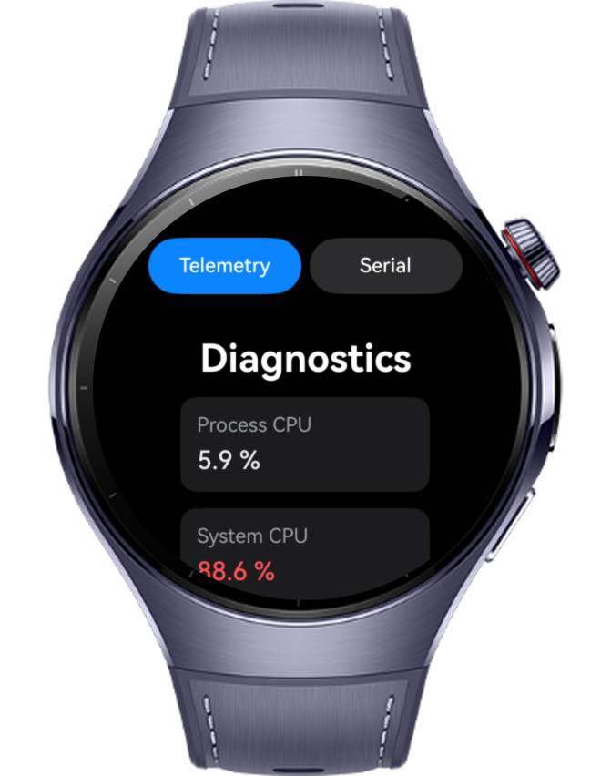
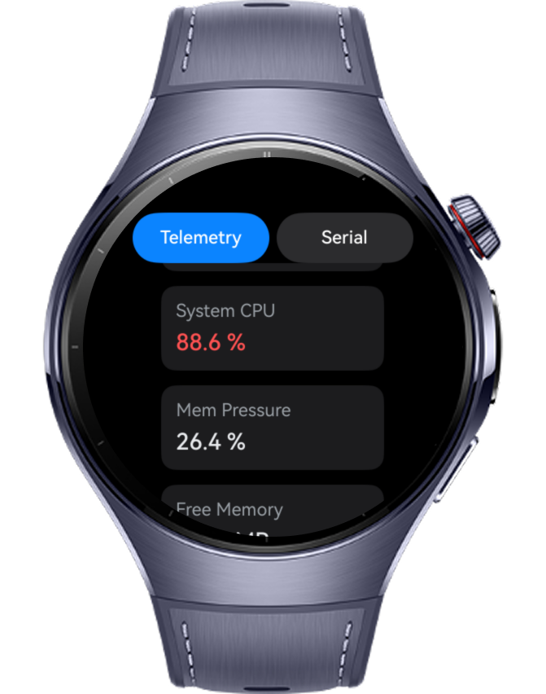
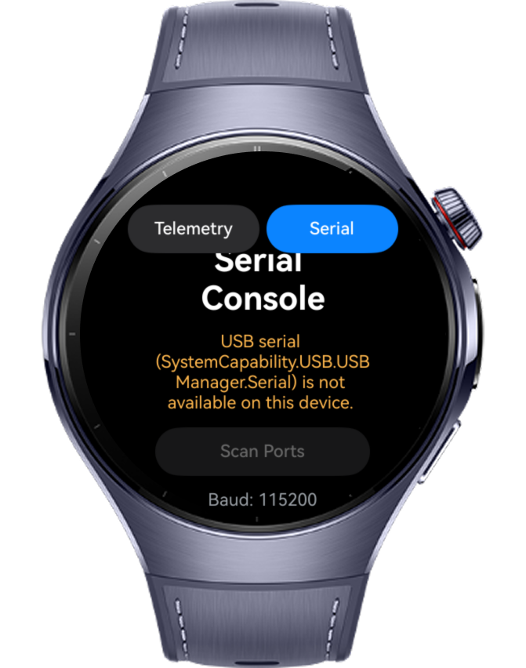
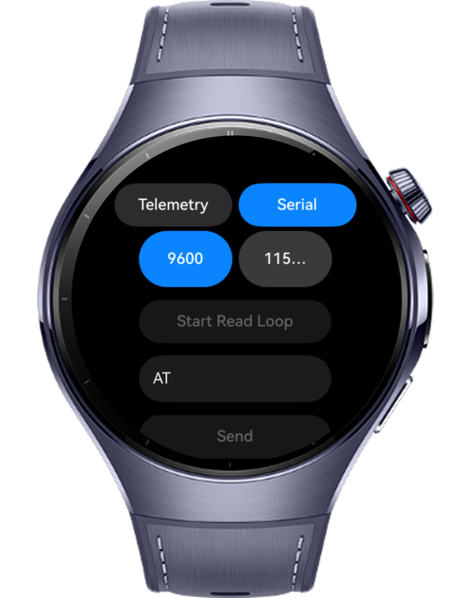

> **Note:** To access all shared projects, get information about environment setup, and view other guides, please visit [Explore-In-HMOS-Wearable Index](https://github.com/Explore-In-HMOS-Wearable/hmos-index).

# How To Build System Callback

The **How To Build System Callback** application is a HarmonyOS wearable application that demonstrates how to monitor live device health (CPU load, memory pressure, and thermal state) and drive a debug UART / accessory serial link directly from a smartwatch. It combines a real-time telemetry dashboard, a full serial-port controller, and a display-driven responsive UI to solve on-device hardware bring-up and field diagnostics for wearable engineers and technicians.

# Preview

<div>
    
    
    
    
</div>

# Use Cases

- Scan, request access to, open, and configure a serial port (baud rate, data bits, parity, stop bits) to communicate with a debug UART or accessory over USB serial.
- Poll process/system CPU and memory via `hidebug` and receive thermal-level callbacks, refreshing the dashboard tiles every ~2 seconds without blocking the UI thread.
- Toggle between the **Telemetry** and **Serial** tabs while the layout reads the display geometry and scales margins and fonts to the watch's round or square screen.
- Stream incoming bytes through a cancellable serial read loop (decoded as UTF-8) into a rolling console log, and write outbound payloads as `Uint8Array`.
- Surface a standardized error to the user for every async operation, formatting `BusinessError` codes (e.g. `31400002` "call requestSerialRight first", `801` "capability unsupported") into a readable banner.
- Track the active serial session, port configuration, and a trimmed 200-line stream log in `@Observed` view-models for the lifetime of the screen.
- Reset cleanly on exit: closing the port stops the read loop, and leaving the screen clears the poll timer and unregisters the display and thermal callbacks in `aboutToDisappear`.

# Technology

## Stack

- **Languages**: ArkTS/ArkUI
- **Frameworks**: HarmonyOS SDK 6.0.1(21)
- **Tools**: DevEco Studio Vers 6.0.1.251
- **Libraries**:
    - `@kit.ArkUI` — `display`, `window`
    - `@kit.BasicServicesKit` — `serialManager`, `thermal`, `batteryInfo`, `deviceInfo`, `BusinessError`, `Callback`
    - `@kit.PerformanceAnalysisKit` — `hidebug`, `hilog`
    - `@kit.ArkTS` — `util` (`TextEncoder`/`TextDecoder`)
    - `@kit.AbilityKit` — `UIAbility`
    - `@kit.CoreFileKit` — `BackupExtensionAbility`

# Directory Structure

```

HowToBuildSystemCallback/
├── AppScope/
│   ├── app.json5
│   └── resources/
├── entry/
│   └── src/main/
│       ├── ets/
│       │   ├── entryability/
│       │   │   └── EntryAbility.ets
│       │   ├── entrybackupability/
│       │   │   └── EntryBackupAbility.ets
│       │   ├── model/
│       │   │   └── Types.ets
│       │   ├── utils/
│       │   │   ├── ErrorHandler.ets
│       │   │   └── ResponsiveMetrics.ets
│       │   ├── services/
│       │   │   ├── TelemetryService.ets
│       │   │   └── SerialService.ets
│       │   ├── viewmodel/
│       │   │   ├── TelemetryViewModel.ets
│       │   │   └── SerialViewModel.ets
│       │   ├── components/
│       │   │   ├── TelemetryDashboard.ets
│       │   │   └── SerialController.ets
│       │   └── pages/
│       │       └── Index.ets
│       ├── module.json5
│       └── resources/
├── build-profile.json5
├── hvigorfile.ts
└── oh-package.json5

```

# Constraints and Restrictions

## Supported Devices

- This demo is supported on **HarmonyOS Wearables** (deviceTypes: `wearable`).
- HarmonyOS wearable emulators and physical devices are supported for development and testing.
- Serial features require a device or accessory that exposes a USB-to-serial port and the runtime serial access right (`requestSerialRight`); no `ohos.permission.*` entry is declared for serial access.

## App Limits

- `serialManager` access is granted per-device at runtime via `requestSerialRight` (not a manifest permission); `hidebug`, `thermal`, and `batteryInfo` reads require no permission, but `hidebug` smaps-based reads must stay off the UI thread.
- Serial communication requires physical hardware mapping — `SystemCapability.USB.USBManager.Serial` is `@since 19` and absent on most wearables, where the Serial tab renders an "unavailable" banner instead.
- Async background telemetry (thermal callbacks, CPU/memory sampling) and live serial I/O may not behave fully in the DevEco Previewer; validate on a wearable emulator or physical device.

# License

**How To Build System Callback** is distributed under the terms of the MIT License.  
See the [LICENSE](/LICENSE) for more information.